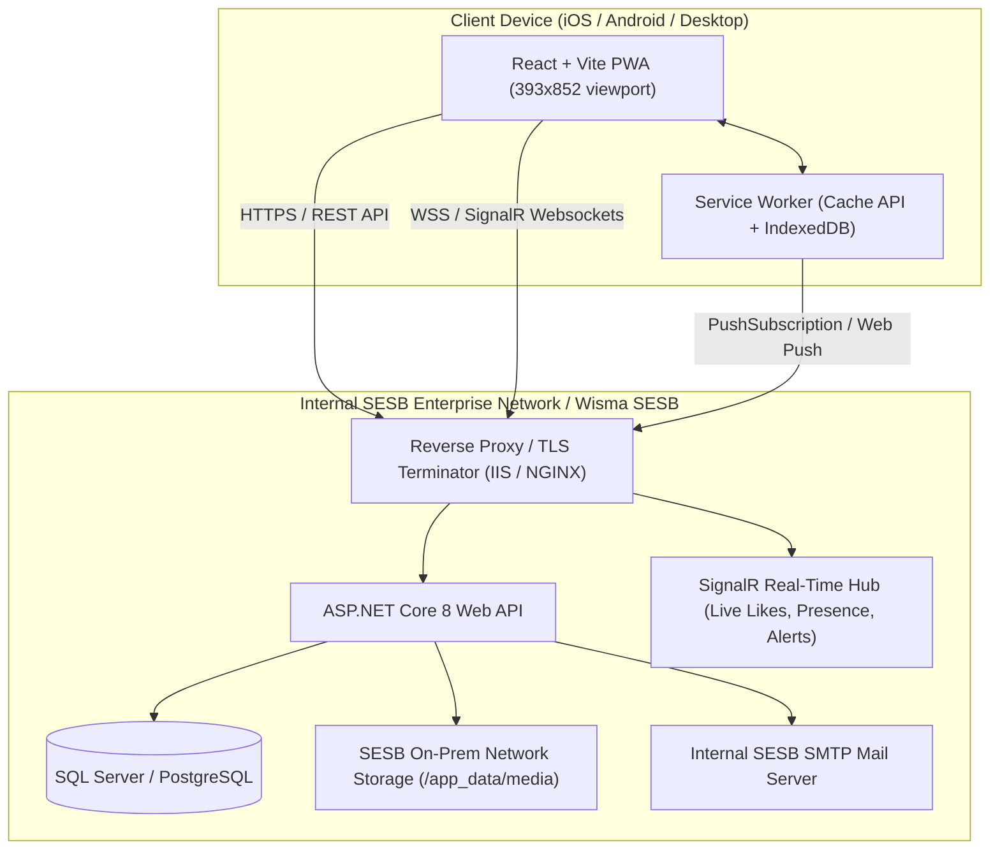
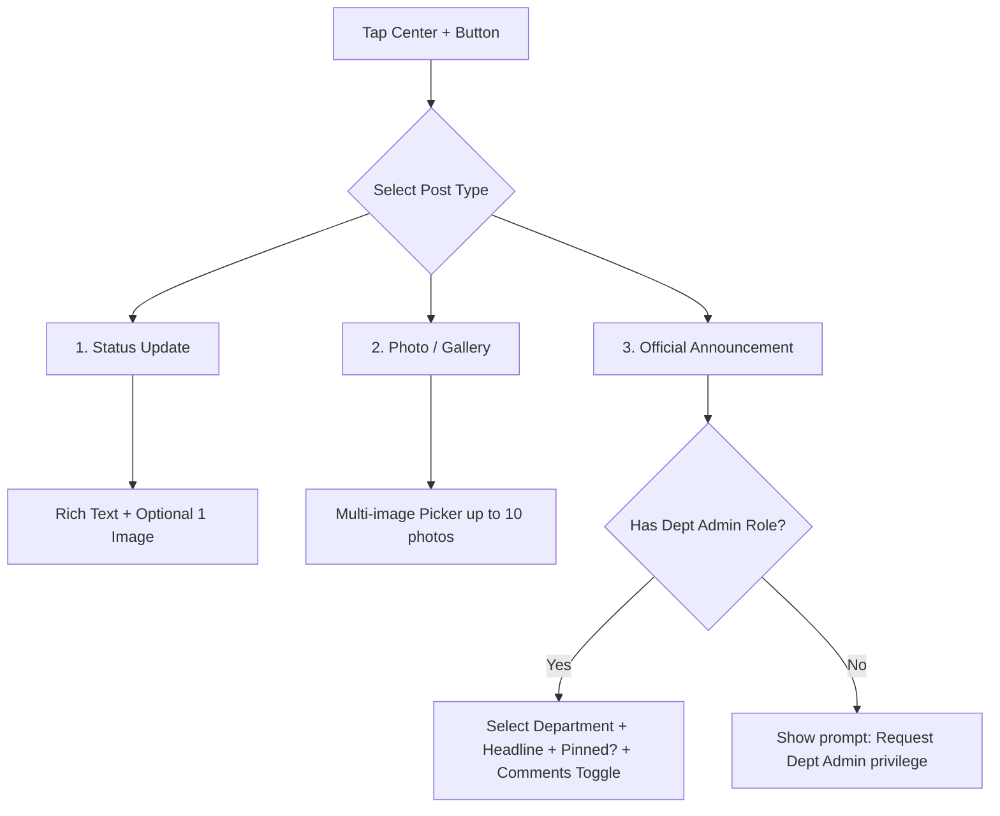
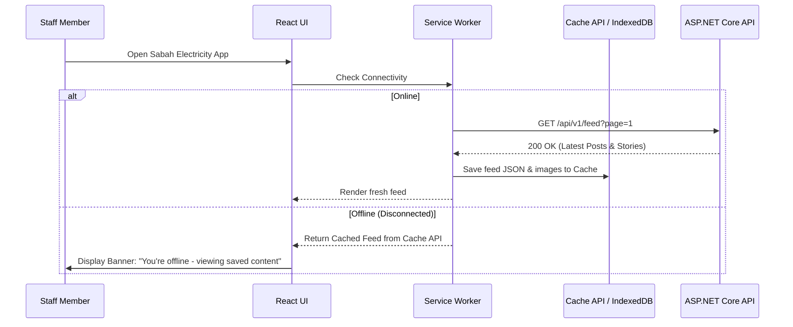
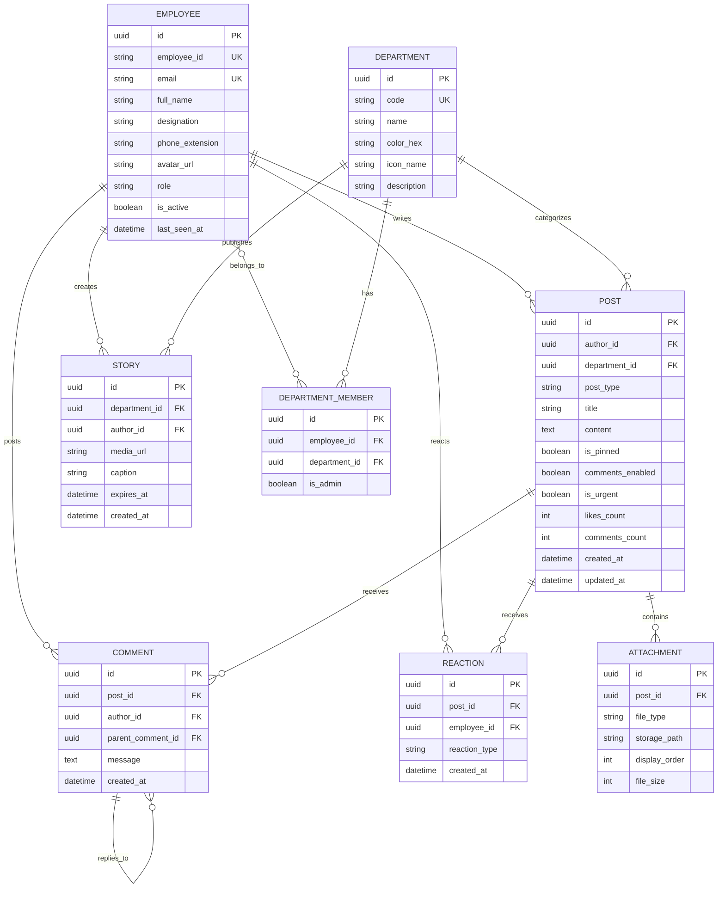
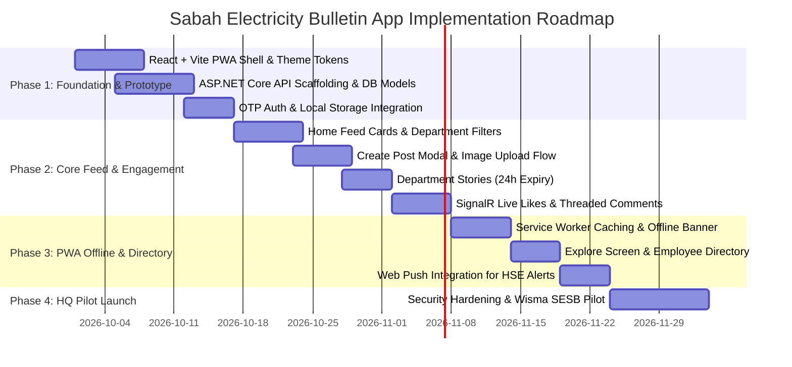

# Sabah Electricity Internal Bulletin App (PWA)
## Software Requirements Specification & Technical Architecture Blueprint

---

## 1. Executive Summary & Vision

**Sabah Electricity Bulletin** (formerly SESB) is an internal corporate social bulletin and communication Progressive Web App (PWA) built for Sabah Electricity Sdn. Bhd. 

The primary objective is to replace fragmented internal email blasts and static intranet notices with a vibrant, modern mobile communication feed. It bridges HQ staff (Wisma SESB, Kota Kinabalu) in Phase 1 before scaling statewide across power stations, regional offices, and field divisions in Sabah & Labuan.

> [!NOTE]
> Designed to feel like a premium corporate social network (Facebook/Instagram-inspired) while strictly complying with Sabah Electricity's enterprise governance, on-premise data residency, and role-based publishing controls.

---

## 2. Brand Identity & Design Tokens

Derived from Sabah Electricity’s corporate identity, the Mount Kinabalu logo geometry, and modern mobile ergonomics:

| Token Category | Token Name | Value | Usage Context |
| :--- | :--- | :--- | :--- |
| **Primary Brand** | `--color-forest-green` | `#1A7A5A` | Kinabalu green peak, primary buttons, story active rings |
| **Primary Brand** | `--color-deep-blue` | `#0055A4` | Kinabalu blue peak, active tab icons, department badges |
| **Accent / CTA** | `--color-accent-green` | `#10B981` | Floating "+" create button, online presence dot, success states |
| **Background** | `--color-bg-canvas` | `#F5F7FA` | App shell, viewport body background |
| **Surface Cards** | `--color-bg-card` | `#FFFFFF` | Post cards, story cards, modals, sheets |
| **Card Borders** | `--color-border-subtle`| `#E8EDF2` | Card outlines, dividers, input borders |
| **Typography** | `--color-text-main` | `#1E293B` | Post titles, headings, primary copy |
| **Typography** | `--color-text-muted` | `#64748B` | Timestamps, designations, counter text |
| **Alert / Warning** | `--color-safety-orange`| `#F59E0B` | HSE warnings, priority announcements |
| **Alert / Critical**| `--color-alert-red` | `#EF4444` | Grid emergency alerts, unread notification badges |
| **Corner Radius** | `--radius-card` | `12px` | Post cards, media previews, dialogs |
| **Elevation** | `--shadow-card` | `0 2px 8px rgba(0, 85, 164, 0.06)` | Subtle brand-tinted drop shadows |

---

## 3. System Architecture & Topology

The platform operates as a decoupled mobile-first Progressive Web App backed by enterprise ASP.NET Core services running inside the SESB corporate network:



---

## 4. User Personas & Role-Based Access Control (RBAC)

| Role | Target Audience | Capabilities & Permissions |
| :--- | :--- | :--- |
| **General Staff** | All verified HQ employees (`@sesb.com.my`) | • Post casual **Status Updates** and **Photo Galleries**.<br>• Comment, like, and share posts.<br>• View Stories, search Employee Directory, edit personal profile.<br>• Cannot publish official department-tagged announcements. |
| **Department Admin** | Appointed officers from HR, Safety (HSE), IT, Operations, Finance, etc. | • All General Staff permissions.<br>• Publish official **Announcements** with department badge.<br>• Publish 24h **Department Stories**.<br>• Toggle comments ON/OFF for department announcements.<br>• Pin up to 2 announcements at top of feed.<br>• Moderate and delete comments on their department's posts. |
| **Super Admin** | Corporate Communications / IT Admins | • Full system administration.<br>• Assign Department Admin roles.<br>• Issue high-priority **HSE / Grid Outage Emergency Broadcasts** with Web Push.<br>• Content audit log and global moderation queue. |

---

## 5. Functional Specifications by Screen

### 5.1 Home Feed (Primary Tab)

```
+---------------------------------------------------+
|  [Logo] Sabah Electricity               [Bell (3)]|
|---------------------------------------------------|
|  (Stories: +Your Story) (HR) (Safety) (Ops) (IT)  |
|---------------------------------------------------|
|  [All] [HR] [Operations] [Finance] [Safety] [IT]  |
|---------------------------------------------------|
|  +---------------------------------------------+  |
|  | [HR Department] [PINNED]             [...]  |  |
|  | (Avatar) Siti Aminah (2h ago)               |  |
|  | Annual Safety & Health Week 2026            |  |
|  | Join us at Wisma SESB Auditorium this...    |  |
|  | [=========== Photo Carousel ============]   |  |
|  | (Heart 42)    (Comment 8)    (Share)        |  |
|  +---------------------------------------------+  |
|  +---------------------------------------------+  |
|  | [Operations]                         [...]  |  |
|  | (Avatar) Ir. Raymond Chin (4h ago)          |  |
|  | Tenom Pangi Hydro Substation Maintenance... |  |
+---------------------------------------------------+
|   [Home*]   [Explore]    [(+)]   [Notifs]  [Profile]
+---------------------------------------------------+
```

- **Top Bar**: Corporate wordmark with Kinabalu blue & green gradient, active real-time network indicator, and notification bell icon with unread count badge.
- **Stories / Highlights Bar**: Circular avatars with **#1A7A5A Forest Green** rings for unread department stories. Auto-expire after 24 hours. Tapping opens full-screen 5-second progress-bar carousel.
- **Department Filter Pills**: Horizontal scroll filter chips (`All`, `HR`, `Operations`, `Finance`, `Engineering`, `IT`, `Safety/HSE`). Instant client-side feed filter with cached fallback.
- **Feed Cards**:
  - Department pill tag (color-coded by division, e.g., HSE is warm amber, IT is deep blue).
  - Pinned announcement indicator when pinned by Department Admin.
  - Poster's avatar with real-time green active presence dot.
  - Rich text body with clickable `#tags` and `@mentions`.
  - Multi-image swipeable carousel with pagination dots.
  - Engagement row: Like (animated heart), Comment (triggers nested bottom-sheet discussion), Share (copy intranet deep-link or share to team).

### 5.2 Create Post Modal / Bottom Sheet (+)

Tapping the center floating green button opens a modal offering three post archetypes:



- **Announcement Fields**:
  - Title / Headline (required, max 120 chars).
  - Department Selector (dropdown limited to departments the user administers).
  - Priority flag (Normal vs Urgent HSE / Operational alert).
  - Engagement controls: Checkbox to enable/disable public comments.
  - Attachments: Multi-image or PDF document link.

### 5.3 Explore Screen (Directory & Discover)

- **Unified Search Bar**: Instant debounce search with auto-suggest across 3 indexes:
  1. **Staff Directory**: Name, Employee ID, Designation, Department, Wisma SESB floor/room, phone extension.
  2. **Posts & Announcements**: Search titles, tags, and body text.
  3. **Departments**: Follow/unfollow departments to tailor the primary feed.
- **Trending & Pinned Bulletins**: Grid of key company circulars, HSE policies, and employee club activities.

### 5.4 Notifications Screen

- Chronological grouping: *Today*, *This Week*, *Earlier*.
- Notification types:
  - Department announcement broadcast from followed departments.
  - Reaction or comment on user's status update.
  - `@Mention` in an announcement or discussion thread.
  - Administrative role assignment.
- One-tap "Mark all as read" button.

### 5.5 Profile & Settings Screen

- Employee avatar with upload/camera trigger.
- Full name, Employee ID, official designation, division/branch.
- Tabs: **My Posts**, **Saved / Bookmarked**, and **Drafts** (local offline drafts).
- Settings: Dark Mode toggle (respects system preference), Notification preferences, Offline cache storage manager (clear cache button), and Logout.

---

## 6. Offline Caching & Progressive Web App (PWA) Strategy



- **Manifest (`manifest.json`)**: Configured with `display: standalone`, custom icons (192px, 512px with Mount Kinabalu logo), splash screen background `#1A7A5A`.
- **Cache Strategy**: *Stale-While-Revalidate* for feed JSON and employee directory; *Cache-First* for static assets, logos, and uploaded image attachments.
- **Web Push Notifications**: Service worker listens for `push` events sent via WebPush standard from ASP.NET Core for emergency broadcasts and followed department bulletins.

---

## 7. Database Entity Relationship Model (ERD)



---

## 8. ASP.NET Core Web API Specifications

### 8.1 Core Endpoints

#### Authentication & Session
- `POST /api/v1/auth/request-otp` — Sends 6-digit OTP to `@sesb.com.my` address via internal SMTP.
- `POST /api/v1/auth/verify-otp` — Verifies OTP, returns signed JWT (`access_token`, `refresh_token`, and user role payload).
- `GET /api/v1/auth/me` — Fetches active staff profile, department admin privileges, and unread counters.

#### Feed & Posts
- `GET /api/v1/feed` — Paginated home feed. Supports `?department=`, `?search=`, and `?type=` queries. Returns posts with nested author profile and attachments.
- `POST /api/v1/posts` — Creates a status update or official announcement (role-checked).
- `PUT /api/v1/posts/{id}/pin` — Toggles pinned state (Department Admin only).
- `DELETE /api/v1/posts/{id}` — Removes post (Author or Department Admin).

#### Engagement
- `POST /api/v1/posts/{id}/reactions` — Toggles like/heart reaction. Dispatches live count update via SignalR.
- `GET /api/v1/posts/{id}/comments` — Retrieves threaded comment hierarchy.
- `POST /api/v1/posts/{id}/comments` — Posts reply (validates `comments_enabled == true`).
- `DELETE /api/v1/comments/{id}` — Moderates/removes inappropriate comment.

#### Stories & Media
- `GET /api/v1/stories` — Retrieves active, non-expired stories grouped by department.
- `POST /api/v1/stories` — Creates department story (auto sets `expires_at = DateTime.UtcNow.AddHours(24)`).
- `POST /api/v1/media/upload` — Multipart file upload. Saves to SESB local storage mount, auto-compresses image to WebP, and generates thumbnails via ImageSharp.

#### Search & Directory
- `GET /api/v1/directory` — Searches employees by name, designation, division, or phone extension.

### 8.2 Real-Time SignalR Hub (`/hubs/bulletin`)
- `OnUserConnected()` — Marks employee online (green active dot).
- `SendReactionUpdate(postId, newCount)` — Instant UI update across all active viewers.
- `BroadcastUrgentAlert(alertDto)` — Triggers in-app banner modal for critical safety/grid updates.

---

## 9. Implementation Roadmap & Phased Milestones


