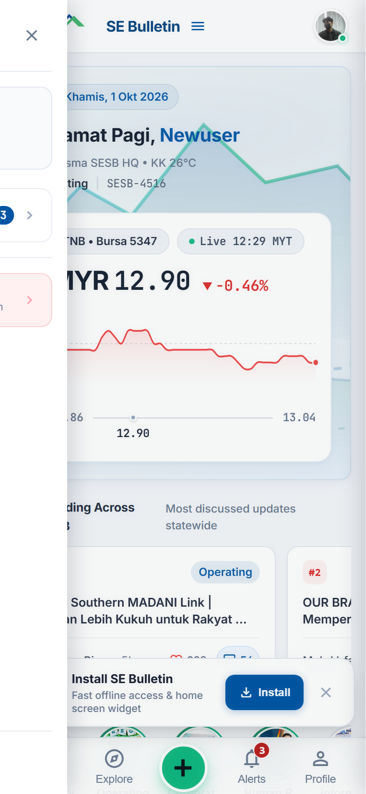
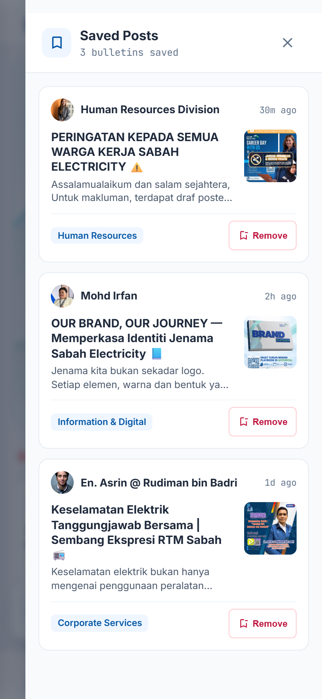
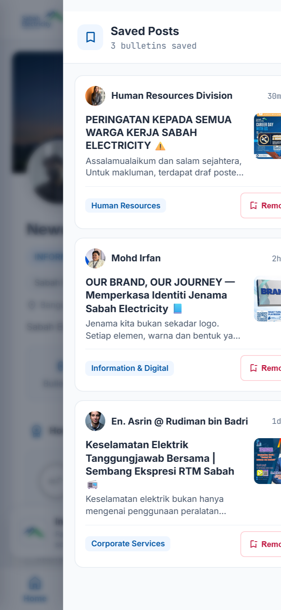
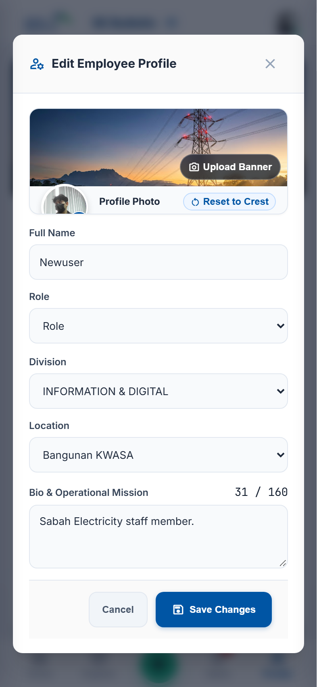

# ⚡ Sabah Electricity Internal Bulletin App (PWA)

> **Corporate Social & Communication Progressive Web App (PWA)**  
> Built for **Sabah Electricity Sdn. Bhd. (SESB)**  
> Scope: **Wisma SESB HQ Staff (Phase 1 Pilot) → Statewide Sabah & Labuan Grid Depots (Phase 2)**

---

## 🌟 Executive Overview

**Sabah Electricity Bulletin** is a modern, mobile-first internal social communication platform designed to replace fragmented corporate email blasts and static intranet circulars. 

It combines the fluid, engaging experience of modern consumer social networks with strict civic governance, role-based announcement controls, authentic Sabah Electricity brand identity, and complete data resilience.

### 📸 Interface Preview

| Brand Sidebar & Navigation | Saved Posts Drawer | Clean Profile View | Edit Profile Modal |
| :---: | :---: | :---: | :---: |
|  |  |  |  |

---

## 🏔️ Key Features & Highlights

1. **Kinabalu & Kota Kinabalu Skyline Hero**:
   - Handcrafted scalable vector illustration featuring Mount Kinabalu's peaks, rolling foothills, Wisma SESB HQ, and transmission pylons with a traveling energy pulse.
   - **Dynamic Lighting Ambiance**: Switchable between ☀️ **Daylight**, 🌅 **Dusk / Sunset**, and 🌙 **Night** (illuminated office windows).
   - **Live Bursa Malaysia Market Ticker (TNB 5347.KL)**: Real-time intraday interactive chart canvas with touch scrubber, magnetic floating price tooltip, and day range indicator.
2. **Decoupled 24-Hour Story Flow & Viewer**:
   - Fast, zero-friction WhatsApp/Instagram-style story creator ([CreateStoryModal.tsx](client/src/features/stories/CreateStoryModal.tsx)) with Photo Mode (instant client compression) and Text Card Mode across 4 SESB brand gradients (Kinabalu Forest, Sabah Blue, Sunset Amber, Night Grid).
   - 5-second auto-advancing full-screen **Story Viewer** with progress bars, keyboard navigation, and pause-on-press.
3. **Interactive Bulletin Feed & Discussions**:
   - Department filter pills with live post count badges.
   - Author avatars, verified badges, station location tags, and official notice banners.
   - **Views Counter Metric**: Eye icon with `viewsCount` in `font-mono tabular-nums`, tracked with `sessionStorage` deduplication (`sesb_viewed_bulletin_ids`).
   - **Optimistic Interactions & Reactions**: Tactile heart like pop or long-press dock ([EmojiReactionDock.tsx](client/src/features/post/EmojiReactionDock.tsx)) with 5 professional reactions (Like, Celebrate, Support, Insightful, Safety).
   - **Reshare & Quote Reposts**: Share bottom sheet ([ReshareBottomSheet.tsx](client/src/features/post/ReshareBottomSheet.tsx)) offering 1-tap instant repost or custom quote commentary with embedded card preview ([QuoteBulletinModal.tsx](client/src/features/post/QuoteBulletinModal.tsx)).
   - **Interactive Poll Cards**: Real-time single-choice voting with animated percentage distribution bars ([InteractivePollCard.tsx](client/src/features/post/InteractivePollCard.tsx)).
   - **Threaded Discussion Drawer**: Slide-up bottom drawer with live comment updates and sticky reply input.
   - **CEO Wisdom & SESI Knowledge Hub**: Leadership quote banner ([CeoWisdomSection.tsx](client/src/features/feed/CeoWisdomSection.tsx)) and corporate crest card ([SesiKnowledgeHubBanner.tsx](client/src/features/feed/SesiKnowledgeHubBanner.tsx)).
4. **Brand Logo Slide-out Menu**:
   - Tapping the top Sabah Electricity logo opens a navigation drawer ([BrandSidebarDrawer.tsx](client/src/layout/BrandSidebarDrawer.tsx)) with active user badge, shortcut to Saved Posts, and Log Out.
5. **Saved Posts Drawer**:
   - Dedicated slide-out drawer ([SavedPostsDrawer.tsx](client/src/features/post/SavedPostsDrawer.tsx)) to review and manage bookmarked bulletins.
6. **Bulletin Studio & SESB Quick Templates**:
   - Dedicated creation suite ([CreateBulletinPage.tsx](client/src/features/create/CreateBulletinPage.tsx)) featuring fixed 44px avatar layout, official notice toggle, client-side compression meter, and **4 1-Tap SESB Quick Templates** (🚨 Keselamatan Goal Zero, ⚡ Penyelenggaraan Grid, 📢 Hebahan Rasmi HQ, 📊 Undian Warga Kerja).
7. **Client-Side Canvas Image Compression Engine**:
   - High-efficiency downscaling ([imageCompressor.ts](client/src/utils/imageCompressor.ts)) reducing mobile camera uploads by ~95% (4.8MB $\rightarrow$ 210KB) to safeguard Supabase free storage quotas and prevent `localStorage` overflow.
8. **Employee Directory Search**:
   - Search across staff names, employee IDs, departments, and phone extensions with one-tap dialer triggers.
9. **Staff Profile & Customization**:
   - Streamlined profile view with locked Sabah Grid Horizon banner, authentic Sabah Electricity crest, Bangunan KWASA location, and official role hierarchy.
10. **Full PWA Installability**:
   - Offline-capable Service Worker cache, Web Manifest, iOS 3-step illustrated install sheet, and Android 1-click install banner.

---

## 🏛️ Architecture & Phasing Roadmap

```
SE-Bulletin/
├── client/                 # React 19 + TypeScript + Vite PWA (Active Pilot Frontend)
│   ├── public/             # PWA assets, manifest.json, sw.js, brand assets, _redirects
│   ├── src/                # Modular UI components, unified services, types, design tokens
│   ├── .env.example        # Environment variables template
│   └── package.json
├── server/                 # ASP.NET Core 8 Web API + SignalR (Phase 2 On-Premises Backend)
├── docs/                   # Engineering documentation, guides & screenshots
│   ├── PILOT_DEPLOYMENT_GUIDE.md  # Supabase & Cloudflare step-by-step pilot runbook
│   ├── stitch-design-reference.md # Design system screen references
│   └── screenshots/               # Automated test UI evidence screenshots
├── scripts/                # Automated verification runners (verify-ui.mjs)
├── PROJECT_SPEC.md         # Full Software Requirements Specification & API contracts
├── GATES.md                # Quality gates & verification acceptance records
└── AGENTS.md / GEMINI.md   # Impeccable craft rules & engineering protocols
```

### Phase 1 Pilot (Current Active Architecture)
- **Frontend Hosting**: **Cloudflare Pages** (Vite static bundle, global CDN, automated SSL/HTTPS).
- **Backend & Database**: **Supabase** (Managed PostgreSQL, PostgREST REST API, WebSocket Realtime Engine for live comments).
- **Media Storage**: **Supabase Storage** (`bulletin-media` public bucket).
- **Offline / Zero-Config Resilience**: If Supabase credentials are not provided, the client automatically falls back to rich built-in mock corporate data in `src/services/mockData.ts`. New team members can start developing immediately with zero backend configuration!

### Phase 2 Enterprise (Wisma SESB On-Premises Target)
- **Backend API**: ASP.NET Core 8 Web API (C#) in `server/`.
- **Real-Time Hub**: SignalR Hub (`/hubs/bulletin`) for live reactions and emergency HSE broadcasts.
- **Database**: On-premise Microsoft SQL Server / PostgreSQL.
- **Storage**: Internal SESB network storage mount (`/app_data/media`).
- See [`server/README.md`](server/README.md) and [`PROJECT_SPEC.md`](PROJECT_SPEC.md) for details.

---

## 🚀 Getting Started (New Team Member Quickstart)

### 1. Prerequisites
- **Node.js** (v18.0 or higher)
- **npm** (v9.0 or higher)

### 2. Setup & Run
```bash
# 1. Clone the repository
git clone https://github.com/petrus-terus/SE-Bulletin.git
cd SE-Bulletin

# 2. Enter the frontend client
cd client

# 3. Install dependencies
npm install

# 4. (Optional) Set up environment variables
cp .env.example .env.local
# Note: Leaving .env.local empty defaults to rich offline mock data!

# 5. Start the local development server
npm run dev
```

The application will be live at:
**[http://localhost:3001/](http://localhost:3001/)**

> 💡 **Mobile Viewport Tip**: Press `F12` in Chrome/Edge, toggle the Device Toolbar (`Ctrl+Shift+M`), and select **iPhone 14/15 Pro (393 × 852)** for the native mobile experience.

### 3. Key NPM Commands (in `client/`)
```bash
npm run dev      # Start dev server on port 3001
npm run build    # Run TypeScript check (tsc -b) & bundle for production
npm run lint     # Run oxlint for defect detection (zero warnings standard)
npm run preview  # Test the production build locally
```

---

## 🎨 Craft Standards & Design Tokens

Built strictly in accordance with Sabah Electricity's **Impeccable Craft Standards** (Pure Modern CSS & CSS Modules; **Zero Tailwind CSS**):

| Token Category | CSS Variable | Hex Value | Usage Context |
| :--- | :--- | :--- | :--- |
| **Forest Green** | `--color-forest-green` | `#1A7A5A` | Kinabalu green peak, active story rings, primary CTAs |
| **Deep Blue** | `--color-primary-container` | `#0055A4` | Kinabalu blue peak, active tab icons, department chips |
| **Accent Green** | `--color-accent-green` | `#10B981` | Floating "+" create button, online presence dot |
| **Dark Ink (WCAG AAA)** | `--color-dark-ink` | `#0B0F17` | **10.8:1 WCAG AAA text** on emerald/green elements |
| **Canvas Background**| `--color-surface-base` | `#F5F7FA` | App shell, viewport body background |
| **Card Surface** | `--color-surface-card` | `#FFFFFF` | Feed cards, modals, sheets (`border-radius: 12px`) |
| **Instrumentation** | `tabular-nums` / `font-mono` | — | Counters, timestamps, stock price, staff IDs (`SESB-1001`) |

### Core Engineering Rules
1. **Zero UI Slop**: Keep cards, headers, and navigation clean and uncluttered. Maintain 16–20px feed spacing.
2. **WCAG AAA Contrast**: Never place white text on emerald green (`#10B981`, 2.54:1 fail). Always use dark ink text (`#0B0F17`, 10.8:1 AAA pass).
3. **No Layout Shift on Counter Updates**: Always apply `font-mono tabular-nums` to numbers that change dynamically.
4. **Mobile Touch Ergonomics**: `touch-action: manipulation` and `-webkit-tap-highlight-color: transparent` to eliminate mobile tap latency. Minimum 44×44px touch targets.

---

## 🧪 Verification & Automated Testing

Automated end-to-end headless verification is available via Chrome DevTools Protocol in [`scripts/verify-ui.mjs`](scripts/verify-ui.mjs):

```bash
# Run automated mobile UI verification (requires Chrome remote debugging on port 9222)
node scripts/verify-ui.mjs
```

This verifies the Brand Sidebar Drawer, Saved Posts Drawer, Profile Page, and Edit Profile Modal in a mobile viewport (393×852) and captures visual evidence in `docs/screenshots/`.

---

## 📚 Documentation Reference

- [`PROJECT_SPEC.md`](PROJECT_SPEC.md) — Comprehensive Software Requirements Specification & Technical Architecture.
- [`docs/PILOT_DEPLOYMENT_GUIDE.md`](docs/PILOT_DEPLOYMENT_GUIDE.md) — Step-by-step pilot deployment runbook (Supabase SQL schemas & Cloudflare setup).
- [`GATES.md`](GATES.md) — Feature verification checklist & acceptance criteria records.
- [`AGENTS.md`](AGENTS.md) — Engineering rules, design system tokens, and contribution standards.
- [`server/README.md`](server/README.md) — Phase 2 ASP.NET Core 8 Web API backend roadmap.
- [`client/README.md`](client/README.md) — Frontend client developer guide.

---

## 🏢 Corporate Ownership & Rights

© 2026 **Sabah Electricity Sdn. Bhd. (SESB)**. Internal corporate software project. All rights reserved.
